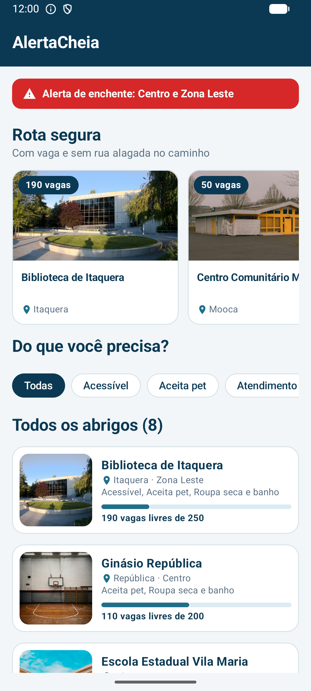
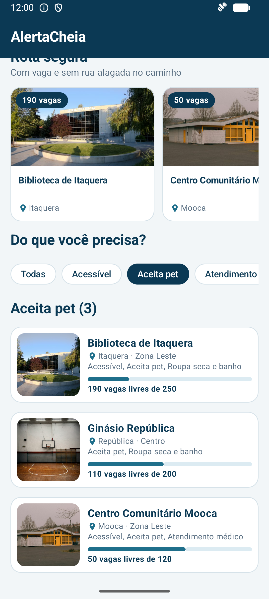
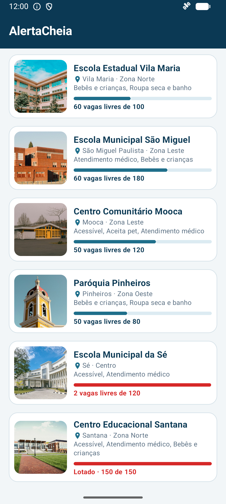

# AlertaCheia · Android

App Android do AlertaCheia, feito em Kotlin com Jetpack Compose para a Global Solution 2026.2 da FIAP.

## Desenvolvedores

| Nome completo | RM |
| --- | --- |
| Filipi de Oliveira | 555484 |
| João Gabriel Silva dos Santos | 575198 |

Equipe CulturaC6, turma 3SIZ.

## Tema da Global Solution

Desafio FIAP CitizenTech. O nosso problema são as enchentes.

## A solução

Quando chega o alerta de enchente, o morador desalojado precisa saber para qual abrigo ir. O AlertaCheia mostra numa tela só as regiões em alerta, os abrigos com vaga e a lista completa, filtrada pelo que ele precisa.

## Funcionalidades

- **Alerta de enchente:** faixa no topo com as regiões em alerta.
- **Rota segura:** abrigos com vaga e sem rua alagada no caminho, escolhidos por uma regra no repositório.
- **Filtro por necessidade:** chips de Todas, Acessível, Aceita pet, Atendimento médico, Bebês e crianças e Roupa seca e banho.
- **Lista de abrigos:** foto, nome, bairro, atendimentos e barra de ocupação, ordenada por vagas. Com 10 vagas ou menos, fica vermelho.

## Fluxo de telas

O app tem uma tela, a `HomeScreen`. Ela abre no alerta e na Rota segura. Ao tocar num chip, a lista abaixo mostra só os abrigos com aquele atendimento. "Todas" volta para a lista completa.

## Prints

| Início | Filtro "Aceita pet" | Fim da lista |
| --- | --- | --- |
|  |  |  |

## Fonte dos dados

Repositório em memória, a classe `AbrigoRepository`, com 8 abrigos fictícios de São Paulo. As fotos vêm do [Unsplash](https://unsplash.com) e são carregadas com Coil.

## Arquitetura e packages

```
br.com.filipideoliveira.alertacheia
├── MainActivity.kt            abre o app no tema e na HomeScreen
├── model/
│   ├── Categoria.kt           enum com os 5 atendimentos
│   └── Abrigo.kt              data class do abrigo
├── data/
│   └── AbrigoRepository.kt    dados, filtro, ordenação e regra da Rota segura
└── ui/
    ├── components/
    │   ├── AbrigoListItem.kt      card da lista vertical
    │   ├── CategoriaSelector.kt   chips do filtro
    │   └── RotaSeguraSection.kt   alerta e destaques horizontais
    ├── screens/
    │   └── HomeScreen.kt          junta tudo e guarda a categoria escolhida
    └── theme/                     cores e tema do Material 3
```

O repositório filtra, ordena e decide os destaques. A `HomeScreen` guarda a categoria com `remember { mutableStateOf() }`, e os componentes só desenham o que recebem.

**Tecnologias:** Kotlin, Jetpack Compose, Material 3 e Coil 3.

## Como rodar

Abrir a pasta no Android Studio, esperar o Gradle sincronizar e rodar o módulo `app` num emulador ou celular com Android 7.0 ou superior, com internet para as fotos.

## Vídeo pitch

Link do vídeo: a definir
